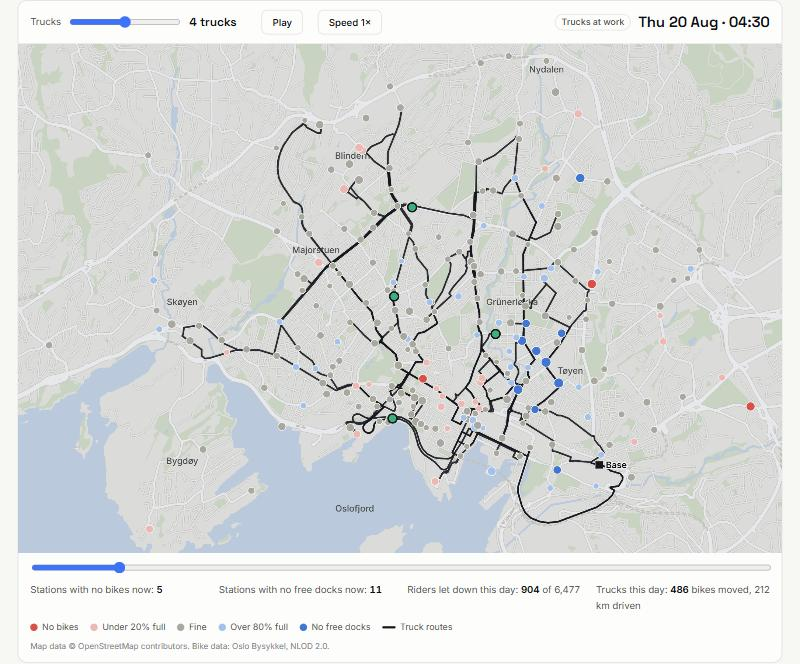
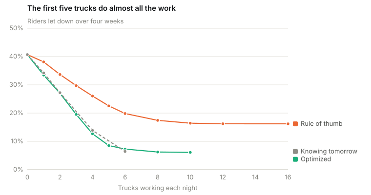

# city-bike

Optimizing city-bike allocation over-night, as the white collars and latte-drinkers sleep
tight awaiting a full bike rack the next morning.



Oslo's city bikes roll downhill. By evening the stations in the hills are empty and the
centre is full. This project plans the trucks that carry the bikes back: where each truck
should go, how many trucks are worth paying for, and when they should work. It uses a
year of real Oslo Bysykkel trips and real Oslo streets.

**Read the [report](report/report.md)** for the full story.

## What we found

Four weeks of real rides (161,183 of them) were replayed for each policy. A rider is
*let down* when there is no bike to take or no free dock to park it.

| Trucks each night | Optimized | Rule of thumb |
|---:|---:|---:|
| 0 | 40.7% let down | 40.7% |
| 2 | 27.0% | 33.7% |
| 4 | 12.7% | 26.0% |
| 5 | 8.5% | 22.6% |
| 10 | 6.1% | 16.4% |

- **Optimized trucks beat the rule of thumb by a wide margin.** Three optimized trucks
  do as well as six that follow the rule "fullest station to emptiest station". The rule
  did not get below 16%, with up to 16 trucks.
- **The first five trucks do almost all the work.** Each of the first four spares about
  400 riders a day. After five, more night trucks add little.
- **Five trucks pay for themselves if a let-down rider costs about one fare.** A single
  ride earns about 17 kr. Each of the first four trucks pays for itself at 8 kr per
  let-down rider and the fifth at 12 kr. A night shift costs about 2,900 kr, built up
  from the legal minimum wage, a night supplement, social costs and overhead.
- **Some trucks should work at midday.** Night trucks alone did not get below 6%, even
  with ten. Six trucks split three and three between night and midday reach 5.7%, and
  cost less, because a midday shift carries no night supplement.
- **Plans should look further ahead than tomorrow.** A bike moved tonight still helps the
  day after. When each station is valued over two days instead of one, four trucks let
  down 9.9% of riders instead of 12.4%, and 8.9% when valued over a week. That is nearly
  what a fifth truck would add, at no cost. It helps most with three to five trucks.
- **Fuel hardly matters.** A truck drives about 50 km a night, around 5% of what it costs.
  The driver's time is what counts.



## See it move

The result pages have an animated map: the city through the day, stations turning red
when they run out of bikes and blue when they run out of docks, and the trucks driving
their routes along real streets.

| Page | What it shows |
|---|---|
| [`report/first-model/`](report/first-model/) | One truck, one night at a time |
| [`report/fleet-size/`](report/fleet-size/) | How many trucks, how far ahead to plan, with a cost calculator and the real Oslo map |
| [`report/day-shift/`](report/day-shift/) | Night trucks and midday trucks compared |

GitHub shows these as source code. To see them, clone the repository and open the
`index.html` files in a browser, or turn on GitHub Pages for the repository
(Settings → Pages → deploy from the `main` branch) and open
`https://<user>.github.io/city-bike/report/fleet-size/`.

## How it works

1. **What each station wants.** From eleven weeks of rides we learn one curve per
   station: how many riders it lets down over a day, depending on how many bikes it
   starts with. A hill station wants to start full, a central one nearly empty.
2. **The model.** Each night at 01:00 a mixed-integer model picks each truck's route and
   how many bikes to load or unload at each stop, to make the sum of the curves as small
   as possible. The truck must fit its shift, hold at most 20 bikes and end empty.
3. **The benchmark.** A rule of thumb: load at the fullest station, unload at the
   emptiest ones, and bring each to half full.
4. **The test.** Four further weeks of real rides are replayed against the plans. The
   planner never sees the day it plans for.

The formulation is written out in the [report](report/report.md#32-the-model-for-one-truck).

## Run it yourself

You need [Julia](https://julialang.org/downloads/) 1.13 or newer and a Gurobi licence
(free for academic use). The Gurobi solver itself is downloaded with the Julia package.
The models are written in JuMP, so another solver such as the open-source HiGHS can be
swapped in where Gurobi is not available.

Install the dependencies and run the tests:

```bash
julia --project=. -e "using Pkg; Pkg.instantiate()"
```

```bash
julia --project=. -e "using Pkg; Pkg.test()"
```

Download a year of Oslo trips and the station feed (215 MB), then the streets and map
features from OpenStreetMap (15 MB). Both go into `data/raw/`, which is not committed:

```bash
julia --project=. scripts/download_oslo.jl 2025-11 2026-10
```

```bash
julia --project=. scripts/download_osm.jl
```

Then run the experiments. Each writes to `results/`, which is not committed, and the
page and figure scripts collect what the pages and the report need into `report/`.

| Command | What it does | Time |
|---|---|---|
| `julia --project=. notebooks/explore_oslo.jl` | First look at the data | 1 min |
| `julia --project=. scripts/build_map.jl` | Base map for the pages | 1 min |
| `julia --project=. scripts/first_model.jl` | One truck, straight-line driving | 20 min |
| `julia --project=. scripts/fleet_size.jl run optimal 4` | Four weeks with 4 optimized trucks; also `greedy`, `oracle`, `none` | 5 to 25 min each |
| `julia --project=. scripts/day_shift.jl run 2 2 split` | 2 night trucks and 2 midday trucks | 20 min each |
| `julia --project=. scripts/sensitivity.jl run capacity 30 4` | Change one assumption | 20 min each |
| `julia --project=. scripts/look_ahead.jl run 2 4` | 4 trucks whose plans look 2 days ahead; `table` lists the runs | 5 to 40 min each |
| `julia --project=. scripts/fleet_size.jl page` | Collect the runs for the fleet-size page | 1 min |
| `julia --project=. scripts/day_shift.jl page` | Collect the runs for the day-shift page | 1 min |
| `julia --project=. scripts/foresight_check.jl 4` | Compare planning from history with knowing tomorrow, night by night | 30 min |
| `julia --project=. scripts/solver_study.jl 4 60` | Replay with 60 seconds of solver time per truck | 2 hours |
| `julia --project=. scripts/figures.jl` | Draw the report's figures | 1 min |

The replays are independent, so several can run at once.

## Layout

| Path         | Purpose                                                  |
|--------------|----------------------------------------------------------|
| `src/`       | The `CityBike` package: data loading, demand curves, street network, simulator, benchmark and model |
| `test/`      | Tests for the code in `src/`                             |
| `scripts/`   | Data downloads, experiments, page data and figures       |
| `notebooks/` | Exploratory analysis                                     |
| `report/`    | The report, its figures and the result pages             |
| `data/`      | Downloaded data, in `data/raw/` — not committed          |
| `results/`   | Experiment output — not committed                        |

## Data and licences

| Source | What | Licence |
|--------|------|---------|
| [Oslo Bysykkel historical trips](https://oslobysykkel.no/en/open-data/historical) | One row per ride: start and end time, start and end station | [NLOD 2.0](https://data.norge.no/nlod/en/2.0) |
| [Oslo Bysykkel station feeds](https://oslobysykkel.no/en/open-data/realtime) | Station locations and docks, live bikes available | NLOD 2.0 |
| [OpenStreetMap](https://www.openstreetmap.org/copyright) | Streets, one-way rules, speed limits, coast and parks | ODbL |

Code is released under the [MIT licence](LICENSE). The bike data belongs to Oslo Bysykkel
and the map data to the OpenStreetMap contributors. `report/map/oslo.js`,
`report/*/map.js` and the street routes in `report/*/data.js` are derived from
OpenStreetMap and stay under the ODbL.

## About

A personal project, not coursework. The formulation, code, analysis and report were
written by Claude (Anthropic's AI model) working with the author, who set the questions
and steered the choices.
