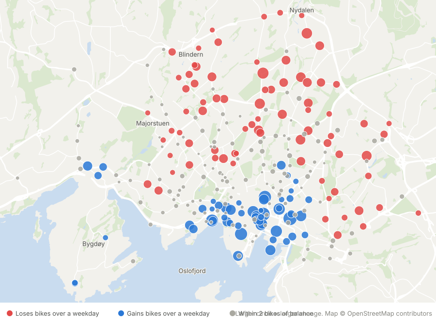
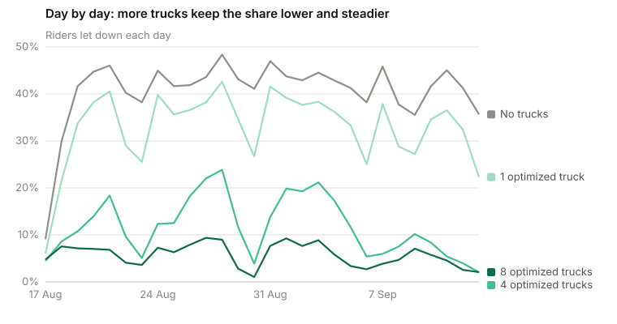
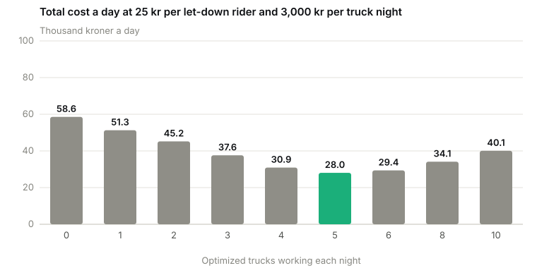
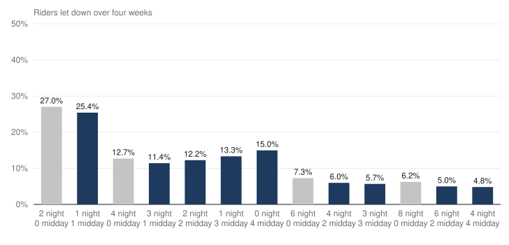
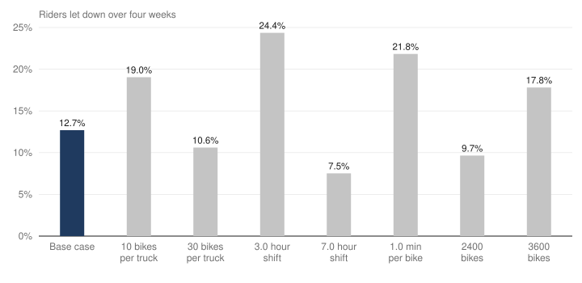

# Keeping Oslo's city bikes where riders need them

*Overnight rebalancing of Oslo Bysykkel with optimized trucks. November 2026.*

Interactive versions of the results, with an animated map, are in
[`first-model/`](first-model/), [`fleet-size/`](fleet-size/) and
[`day-shift/`](day-shift/). Open `index.html` in a browser.

## Summary

Oslo's city bikes roll downhill. Every summer weekday about 900 bikes end the day at a
different station than they started, leaving the hills empty and the centre full. We
asked how trucks working at night should move bikes back, how many trucks are worth
paying for, and when they should work.

We learned from eleven weeks of real trips what each station needs, wrote an
optimization model that plans the trucks' routes and loads, and tested it by replaying
four further weeks of real trips (161,183 rides) that the model had never seen. A rider
is *let down* when there is no bike to take or no free dock to park it.

- **Without any rebalancing, 40.7% of riders are let down.** The system fills up and
  empties out within three days.
- **Optimized trucks beat a rule of thumb by a wide margin.** Four optimized trucks leave
  12.7% of riders let down. Trucks that follow the rule "fullest station to emptiest
  station" never get below 16.2%, however many there are.
- **The first five trucks do almost all the work.** Five trucks reach 8.5%, ten reach
  6.1%. What is left happens during the day, which night trucks cannot fix.
- **Four trucks pay for themselves if a let-down rider costs more than about 9 kr.** A
  single ride earns about 17 kr. The fifth truck needs 13 kr, the sixth 44 kr.
- **Some of the trucks should work at midday.** Night trucks alone never get below 6%.
  Six trucks split three at night and three at midday reach 5.7%, better than ten trucks
  at night, and eight split four and four reach 4.8%.
- **Fuel hardly matters.** A truck drives about 50 km a night. The driver's time is what
  costs, so the model's job is to make every hour of the shift count.

## 1. The problem and why it matters

Oslo Bysykkel runs about 3,000 bikes at around 260 docking stations inside Ring 3. A
ride is short and one-way: the median is 9 minutes and 1.5 km, and only 1.6% of rides
return to the station they started from. Because Oslo slopes down towards the fjord,
riders take bikes downhill and take the tram back up.

The map shows the result. Stations in Nydalen, Bjølsen, Torshov and around Blindern lose
12 to 23 bikes on an average summer weekday. Stations in the centre and on the
waterfront gain 20 to 35. One station, Tøyenbekken, gains 35 bikes a day and has 30
docks. Left alone, the hills run out of bikes and the centre runs out of docks, and a
rider who meets either has been let down.

The operator fixes this by driving bikes back uphill. That costs drivers and vehicles,
so three questions matter to whoever runs the system: where should each truck go, how
many trucks are worth paying for, and when should they work.

A weekday has two rush hours, at 08:00 and at 16:00. The system never closes, but only
2.4% of weekday rides start between 01:00 and 06:00. That is the natural window for
trucks, and the one we start with.

## 2. The data

| Source | What we used | Licence |
|---|---|---|
| Oslo Bysykkel trip history | 1.17 million rides from November 2025 to October 2026: start and end time, start and end station | NLOD 2.0 |
| Oslo Bysykkel station feed | Location and number of docks for 261 stations (5,740 docks) | NLOD 2.0 |
| OpenStreetMap | 7,900 drivable street segments, one-way rules and speed limits; coast, parks and water for the map | ODbL |

Everything in the model is real data except the points listed under
[What we assumed](#what-we-assumed). Three gaps in the data shaped the work:

- **No inventories.** The trip files show rides, not how many bikes stood where. We
  therefore simulate: every replay starts with the 3,000 bikes spread evenly, and the
  real rides then move them.
- **No record of the operator's own trucks.** The rides we replay happened while the
  real operator was rebalancing around the clock. Our runs with no trucks are therefore
  worse than real life ever was.
- **Demand is understated.** An empty station records no departures, so rides that
  never happened are missing from the history.

## 3. How we tackled it

### 3.1 What each station wants

The heart of the method is one curve per station. It answers: *if this station starts
the day with this many bikes, how many riders will it let down?* We get it by replaying
each historical day at that station alone, for every possible starting level, and
averaging over the days. Weekdays and weekends get separate curves.

Stavangergata, in the hills, wants to start the day full: with 29 of its 30 docks
occupied it lets down about 2 riders a day, and empty it lets down 22. Tøyenbekken, in
the centre, wants to start empty so that arriving riders find docks: even then it lets
down 9 riders a day, and full it lets down 37.

These curves have a useful shape. Each one is *convex*: every extra bike helps a little
less than the one before, until it starts to hurt. We checked this for all 261 stations.
It means the model below stays linear and a solver can handle it.

Because the curves are averages over many past days, they already carry the uncertainty
about tomorrow. Minimising their sum is minimising the *expected* number of riders let
down.

### 3.2 The model for one truck and one night

At 01:00 the model sees where the bikes are. It chooses the truck's route and how many
bikes to load or unload at each stop, to make the sum of the stations' curves as small
as possible.

**Sets and data**

- $N$: the stations worth a visit tonight (the 15 to 20 that gain most from losing
  bikes and the 15 to 20 that gain most from receiving them); $0$ is the base.
- $b_i$: bikes at station $i$ at 01:00. $C_i$: its docks.
- $F_i(s)$: riders let down tomorrow if station $i$ starts with $s$ bikes.
- $t_{ij}$: driving minutes from $i$ to $j$ along the streets.
- $Q = 20$ bikes on the truck, $T = 300$ minutes in the shift, 3 minutes per stop and
  half a minute per bike handled.

**Decisions**

- $x_{ij} \in \{0,1\}$: the truck drives from $i$ to $j$. $y_i \in \{0,1\}$: it visits $i$.
- $p_i, d_i \ge 0$, whole numbers: bikes picked up and dropped at $i$.
- $f_{ij} \ge 0$: bikes on board between $i$ and $j$.

**Model**

$$\min \sum_{i \in N} F_i(b_i + d_i - p_i)$$

subject to

| Constraint | Meaning |
|---|---|
| $\sum_j x_{ij} = \sum_j x_{ji} = y_i$ | one way in and one way out of each stop |
| $\sum_j x_{0j} = \sum_j x_{j0} \le 1$ | the tour starts and ends at the base |
| $y_i \le p_i + d_i \le Q\,y_i$ | bikes move only at stops, and every stop moves a bike |
| $\sum_j f_{ij} - \sum_j f_{ji} = p_i - d_i$ | the load changes by what is handled |
| $f_{ij} \le Q\,x_{ij}$, $f_{0j} = f_{j0} = 0$ | the load fits the truck, which leaves and returns empty |
| $\sum_{ij} t_{ij}x_{ij} + 3\sum_i y_i + \tfrac12 \sum_i (p_i + d_i) \le T$ | everything fits in the shift |
| $0 \le b_i + d_i - p_i \le C_i$ | stations stay within their docks |

A second flow ties the stops into one connected tour. Because each $F_i$ is convex, it
enters the model as a set of straight-line constraints, with no extra yes/no variables.
A small penalty per kilometre keeps the route short where riders are not affected. The
model is written in Julia with JuMP and solved with Gurobi.

### 3.3 Several trucks

All trucks could be planned in one model, by letting several tours leave the base and
running a clock along each tour. We built that model too, but it is much harder to
solve. Planning the trucks **one at a time**, each on the bikes the previous trucks
leave behind, is fast and loses almost nothing: on test nights with two, three and four
trucks it came within 1% of the best joint plan the solver found in two minutes. All
results below plan one truck at a time.

### 3.4 The benchmark

To know what optimization adds, we compare with what a dispatcher might do without a
model. The **rule of thumb**: drive to the fullest station and load until it is half
full; drive to the emptiest station and unload until it is half full; repeat until the
shift is over. With several trucks, each follows the rule on what the others leave.

### 3.5 Testing by replay

A plan is only as good as what happens the next day. We test every policy the same way:

1. Learn the curves from rides between 1 June and 16 August 2026.
2. Start on 17 August with 3,000 bikes spread evenly.
3. Each night the planner sees the inventories at 01:00 and the trucks carry out the
   plan, stop by stop.
4. Then the real rides of that day are replayed. A rider who finds no bike gives up. A
   rider who finds no free dock rides on to the nearest station with room.
5. Repeat for 28 days, to 13 September, and count the riders let down.

The planner never sees the rides of the day it plans for. The same 161,183 rides are
replayed for every policy, so differences come from the trucks alone.

## 4. Findings

### 4.1 One truck is not enough

Our first model used one truck. Over the four weeks it cut the share of riders let down
from 40.7% to 34.0%, sparing about 390 riders a day. The rule-of-thumb truck managed
38.5%. In the same five hours the optimized truck moved 135 bikes and the rule-of-thumb
truck 64, because the rule spends its time on many small drops.

But about 900 bikes drift out of place every day. One truck moving 135 of them cannot
hold the line.

### 4.2 How many trucks?

| Trucks each night | Optimized | Rule of thumb |
|---:|---:|---:|
| 0 | 40.7% | 40.7% |
| 1 | 33.4% | 38.1% |
| 2 | 27.0% | 33.7% |
| 3 | 19.5% | 29.7% |
| 4 | 12.7% | 26.0% |
| 5 | 8.5% | 22.6% |
| 6 | 7.3% | 19.8% |
| 8 | 6.2% | 17.4% |
| 10 | 6.1% | 16.4% |
| 16 | – | 16.2% |

Three things stand out.

**Each of the first four trucks spares about 400 riders a day.** The curve is close to a
straight line down to four trucks, then bends. A fifth truck spares 240 riders a day, a
sixth 70, and beyond eight nothing more happens.

**There is a floor at about 6%.** However many trucks work at night, about 350 riders a
day are still let down. Those failures build up during the day: a station that starts
perfectly still fills or empties by the afternoon. Night trucks cannot reach them. The
curves say the same thing without any trucks: even if every station started each day at
its own best level, history says about 340 riders would be let down on a weekday and 160
on a weekend day.

**The rule of thumb has a much higher floor, at 16%.** Bringing every station to half
full is simply the wrong target. A hill station should start nearly full and a central
one nearly empty, and the rule cannot know that. Three optimized trucks (19.5%) do as
well as six rule-of-thumb trucks (19.8%), and four optimized trucks do better than any
number of rule-of-thumb trucks.

Day by day, the runs with no trucks and with one truck collapse within three days and
stay above 22%. With four trucks the share swings between 2% and 24%: the trucks gain
ground over quiet weekends and lose it during busy weeks. With eight trucks it stays
under 10% every day.

### 4.3 What is it worth?

A truck costs money every night. A let-down rider costs something too: a lost fare, and
a customer who trusts the system a little less. That second number is hard to know, so
we turn the question around: *how much must a let-down rider cost before a truck pays
for itself?*

We assume a truck night costs 3,000 kr (about 5.5 paid hours at 450 kr including
employer costs and night supplement, plus about 500 kr for the vehicle) and 3 kr per
kilometre driven.

| Added truck | Riders it spares a day | Pays for itself if a let-down rider costs more than |
|---|---:|---:|
| Truck 1 | 417 | 8 kr |
| Truck 2 | 370 | 9 kr |
| Truck 3 | 430 | 7 kr |
| Truck 4 | 394 | 8 kr |
| Truck 5 | 240 | 13 kr |
| Truck 6 | 72 | 44 kr |
| Trucks 7 and 8, each | 30 | 104 kr |
| Trucks 9 and 10, each | 4 | 854 kr |

A single ride earns about 17 kr (8 kr to unlock and 1 kr a minute, for a typical
9-minute ride). So on lost fares alone, **five trucks pay for themselves**, and a sixth
only does if goodwill is worth another 27 kr per let-down rider.

At 25 kr per let-down rider, five optimized trucks are the cheapest fleet, at about
28,000 kr a day in total. Running no trucks costs 58,500 kr a day in let-down riders.
The best the rule of thumb can do is six trucks at 47,900 kr a day, so optimization is
worth about 20,000 kr a day at these prices. The [fleet-size page](fleet-size/) has
sliders for all three prices.

**Fuel hardly matters.** An optimized truck drives about 50 km a night, which is roughly
150 kr, or 5% of what the truck costs that night. The cost is the driver's time. The
model therefore does best by packing as many useful bike moves as possible into the
shift, not by saving kilometres.

### 4.4 When should the trucks work?

Night trucks set the city up for the morning. By the afternoon the bikes have moved
again, and that is where the 6% floor comes from. So we moved some of the trucks to a
second shift from 10:00 to 15:00, between the two rush hours. The midday trucks get their
own plan at 10:00, from where the bikes are at that moment, using curves that count only
the riders a station would let down during the rest of the day. Midday driving times are
30% longer, for traffic.

| Trucks in total | All at night | Split between night and midday |
|---:|---:|---|
| 2 | 27.0% | 1 + 1: **25.4%** |
| 4 | 12.7% | 3 + 1: **11.4%** · 2 + 2: 12.2% · 1 + 3: 13.3% · 0 + 4: 15.0% |
| 6 | 7.3% | 3 + 3: **5.7%** · 4 + 2: 6.0% |
| 8 | 6.2% | 4 + 4: **4.8%** · 6 + 2: 5.0% |

**Some midday work helps at every fleet size.** Sending one or more of the trucks out at
midday lets down 1.3 to 1.6 percentage points fewer riders than keeping them all at
night.

**Midday trucks get under the night floor.** No number of night trucks got below 6.1%.
Six trucks split three and three reach 5.7%, and eight split four and four reach 4.8%.
Six trucks split over two shifts do better than ten at night.

**Most of the work still belongs at night.** With four trucks, three at night and one at
midday is best. Four at midday and none at night is worst, at 15.0%: a truck is worth
more at night, when streets are quiet and the whole day lies ahead.

**Each shift should plan for the whole day ahead of it.** We also tried a night shift
that only looks as far as 10:00 and leaves the afternoon to the midday trucks. That was
clearly worse: 15.3% against 12.2% with two trucks on each shift. The midday trucks
cannot move enough bikes in five hours to repair an afternoon the night shift ignored.

The midday results are cautious. The plan treats every delivery as if it happened at
10:00, although the truck arrives up to five hours later while riders keep moving bikes.
A plan renewed at every stop, as the real operator's is, would do better. The
[day-shift page](day-shift/) shows the two shifts on the map.

### 4.5 Would better forecasts help?

The planner works from the average of past days. Would it do better if it knew
tomorrow? We let it cheat: instead of history, it planned each night with the real rides
of the coming day.

| Trucks each night | Planning from history | Knowing tomorrow's rides |
|---:|---:|---:|
| 1 | 33.4% | 34.2% |
| 2 | 27.0% | 27.2% |
| 4 | 12.7% | 13.9% |
| 6 | 7.3% | 6.4% |

It makes little difference, and with few trucks it is slightly worse. There are two
reasons.

- **The trucks are limited by what they can carry, not by what they know.** With one to
  four trucks there is far more to fix than the trucks can move, and the worst stations
  are the same every day.
- **A plan fitted to one day is short-sighted.** It gives no value to where the bikes are
  left for the day after. Planning for the average day leaves the system in better
  shape. Only with six trucks, when nearly everything that can be fixed is fixed, does
  knowing tomorrow help.

The same short sight shows in the model's own estimates. On an average night the first
truck expects to spare 217 riders the next day. In the replay it spares 417 a day,
because each night's work carries over to the following days. A model that looked two
days ahead could use this.

For this system, better demand forecasts are not where the gains are. More useful bike
moves per hour, and work during the day, matter more.

### 4.6 What if our assumptions are wrong?

We changed one assumption at a time and replayed the four weeks with four optimized
night trucks. The base case lets down 12.7% of riders.

| Assumption changed | Riders let down |
|---|---:|
| Base case: 20 bikes per truck, 5-hour shift, half a minute per bike, 3,000 bikes | 12.7% |
| Trucks hold 10 bikes | 19.0% |
| Trucks hold 30 bikes | 10.6% |
| 3-hour shift | 24.4% |
| 7-hour shift | 7.5% |
| One minute to load or unload a bike | 21.8% |
| 2,400 bikes in the system | 9.6% |
| 3,600 bikes in the system | 17.8% |

**Time is what the trucks are short of.** Two more hours per shift do more than a truck
that holds half as many bikes again: four trucks on 7-hour shifts (7.5%) match six trucks
on 5-hour shifts (7.3%). Handling time matters as much. If loading a bike takes a minute
instead of half a minute, four trucks (21.8%) do slightly worse than three do at half a
minute (19.5%). Anything that
speeds up loading, such as a trailer with a ramp or a second person, is worth a great
deal.

**Bigger trucks help less than longer shifts.** Going from 20 to 30 bikes per truck takes
the share from 12.7% to 10.6%. Halving the truck to 10 bikes costs more, 19.0%, because
the truck then spends its night driving back and forth.

**More bikes make things worse.** With 3,600 bikes instead of 3,000, the share let down
rises from 12.7% to 17.8%. With 2,400 it falls to 9.6%. The system has 5,740 docks, and
its biggest problem is full stations in the centre, not empty ones in the hills: in the
runs with no trucks, two riders in three who are let down found no dock. Extra bikes fill
the centre faster. Our fleet figure of 3,000 is the operator's own, but we do not know
how many of those bikes are on the street on a given day, so this is the assumption the
results are most sensitive to.

These runs change the size of the numbers, so the fleet sizes and break-even prices
above should be read as estimates for our base case. We did not rerun the rule of thumb
under each change.

## 5. How this compares with real operations

We looked for how Oslo Bysykkel actually works.

- **The base.** The operator, Urban Infrastructure Partner, has its head office,
  warehouse and operations centre at Kværnerveien 5, east of the centre. Our trucks
  start and end there.
  ([source](https://urbaninfrastructure.no/drift/?lang=en))
- **The crews.** Teams of mechanics and drivers of specially adapted trucks. In 2018 the
  operator wrote that it had vehicles out around the clock, every day.
- **Planning.** Researchers at NTNU built an optimization model with the operator in
  which a driver gets a new plan at every station. In their tests it cut problems by 41%
  against no rebalancing and by 24% against the operator's practice at the time.
  ([source](https://norwegianscitechnews.com/2022/08/making-bike-sharing-work/))
- **Not published.** We found no public figure for how many trucks the operator runs or
  how many bikes a truck carries. The 20 bikes per truck is our assumption.

Our numbers are not a description of the real system. The real operator works in the
daytime too, which our night-only runs do not. What carries over is the comparison: on
the same rides, a truck that knows what each station needs does the work of two or more
trucks that follow a simple rule.

## 6. Limits

- **Stations are judged one at a time.** A station's curve assumes its riders arrive as
  they did in history. In the replay, a rider let down at one station changes what
  happens at the next. The replay captures this; the planner does not.
- **Each night is planned for one day ahead.** The planner does not consider that
  tonight's plan also sets up the day after.
- **The solver is stopped after 10 seconds per truck.** On a typical night the worst
  truck's plan was proven to be within about 6% of the best possible. Better plans may
  exist, so the optimized results are a floor on what optimization can do, not a ceiling.
  Because the limit is in seconds and several replays ran at once, a rerun on another
  machine will give slightly different plans and numbers. One configuration happened to
  run twice (four midday trucks) and gave 24,150 and 24,101 riders let down.
- **Only some stations are considered each night.** A station can give bikes only if
  losing them helps the station itself, and the model looks at the 15 best givers and
  the 15 best receivers. A station that could give bikes at no cost to itself is left
  out. This matters most when bikes are scarce.
- **Stations are attached to the nearest street point**, which for a few stations is a
  tunnel or a main road underneath them. Driving times to those stations are off by a
  minute or two.
- **Demand is understated**, because rides that could not happen were never recorded.
- **Every run starts from an even spread of bikes**, not from a real evening.
- **E-bikes are not modelled.** About 38% of the bikes parked in a live snapshot were
  electric, and they need charged batteries. Battery swaps would take truck time that we
  have not counted.
- **Costs are our estimates**, not the operator's.

### What we assumed

| Assumption | Value | Basis |
|---|---|---|
| Bikes in the system | 3,000 | the operator's own figure |
| Bikes per truck | 20 | our assumption |
| Shift | 01:00 to 06:00 | the quiet hours in the data |
| Time per stop | 3 minutes plus half a minute per bike | our assumption |
| Driving speed | 70% of each street's speed limit | our assumption; gives 31 km/h on average |
| A rider who finds no bike | gives up | simplification |
| A rider who finds no dock | rides to the nearest station with room | simplification |
| Truck night | 3,000 kr | our estimate |
| Driving | 3 kr per km | our estimate |

One early assumption could be checked against data. The first model guessed that streets
are 1.4 times longer than straight lines. Along the real streets the median is 1.43.

## 7. With another week

- **Plan through the day.** Replan every hour or two with the trucks already on the road,
  as the operator does, instead of one plan per shift.
- **Add e-bike batteries.** Track which bikes need a battery and let a stop include
  swaps, so that the trucks' time is shared between moving bikes and charging them.
- **Plan two days ahead.** Let tonight's plan weigh where it leaves the system tomorrow
  night.
- **Tighten the solver.** Give the solver more time, or a better starting plan, and
  measure how much the plans improve.
- **Use real inventories.** Collect the live station feed for a season, so that replays
  start from real evenings and can be checked against what actually happened.

## 8. Reproducing the results

Everything is in this repository. See the [README](../README.md) for the commands. The
data downloads take a few minutes and the full set of replays takes a few hours on a
laptop.

This is a personal project, not coursework. The formulation, the code, the analysis and
this report were written by Claude (Anthropic's AI model) working with the author, who
set the questions and steered the choices.

Data: Oslo Bysykkel, Norwegian Licence for Open Government Data (NLOD) 2.0. Map and
streets: © OpenStreetMap contributors, Open Database Licence.
