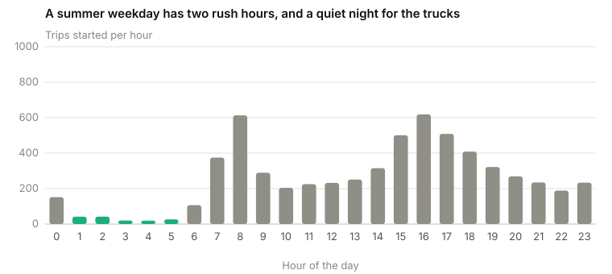
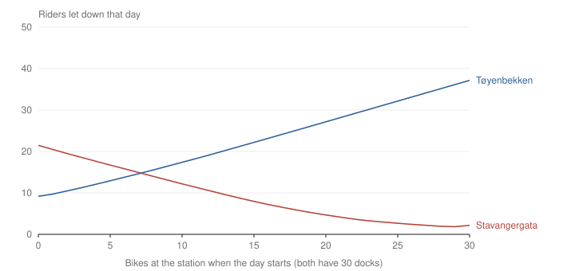
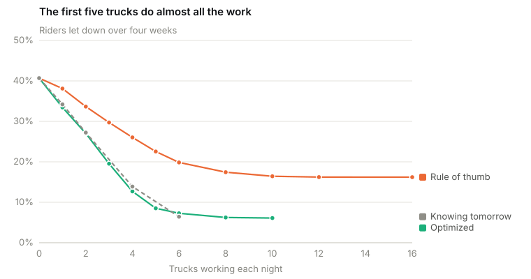

# Keeping Oslo's city bikes where riders need them

Planning the trucks that rebalance Oslo Bysykkel. November 2026.

## Abstract

Oslo's city bikes roll downhill. On a summer weekday the stations that lose bikes lose
about 900 in total, and the hills end the day empty while the centre is full. This report
asks where rebalancing trucks should go, how many trucks are worth paying for, and when
they should work.

We learn from eleven weeks of real rides what each station needs, plan the trucks with a
mixed-integer model, and test the plans by replaying four further weeks of real rides
(161,183 of them) that the planner has not seen. A rider is *let down* when there is no
bike to take or no free dock to park in.

1. With no rebalancing, 40.7% of riders are let down.
2. Four optimized night trucks bring that to 12.7%. Trucks following a simple rule of
   thumb did not get below 16.2%, even with sixteen of them.
3. Five night trucks do almost all that night work can do (8.5%). Ten reach 6.1%.
4. Moving some trucks to a midday shift does better and costs less. Three night trucks
   and three midday trucks reach 5.7%, and are the cheapest fleet we found.
5. A night truck shift costs about 2,900 kr, nearly all of it the driver. Each of the
   first four trucks pays for itself if a let-down rider costs 8 kr or more.

Interactive versions of the results, with an animated map, are in
[`first-model/`](first-model/), [`fleet-size/`](fleet-size/) and
[`day-shift/`](day-shift/).

## 1. Introduction

Oslo Bysykkel runs about 3,000 bikes at some 260 docking stations inside Ring 3. A ride
is short and one-way: the median is 9 minutes and 1.5 km, and only 1.6% of rides return
to the station they started from. Because Oslo slopes down towards the fjord, riders take
bikes downhill and take the tram back up.

*Figure 1. Net change in bikes per station over an average summer weekday, from rides
alone.*

Figure 1 shows the result. Stations in Nydalen, Bjølsen, Torshov and Hasle lose 12 to 23
bikes on an average summer weekday. Stations in the centre and on the waterfront gain 20
to 35. One station, Tøyenbekken, gains 35 bikes a day and has 30 docks. Left alone, the
hills run out of bikes and the centre runs out of docks.

The operator corrects this by driving bikes back uphill. That costs drivers and vehicles,
so three questions matter: where each truck should go, how many trucks are worth paying
for, and when they should work.

*Figure 2. Rides started per hour on a summer weekday. The dark bars are the night shift.*

A weekday has two rush hours, at 08:00 and at 16:00 (Figure 2). The system does not
close, but only 2.4% of weekday rides start between 01:00 and 06:00. That is the natural
window for trucks, and the one we start with.

## 2. Data

*Table 1. Data sources.*

| Source | What we used | Licence |
|---|---|---|
| Oslo Bysykkel trip history | 1.17 million rides from November 2025 to October 2026: start and end time, start and end station | NLOD 2.0 |
| Oslo Bysykkel station feed | Location and number of docks for 261 stations (5,740 docks) | NLOD 2.0 |
| OpenStreetMap | 7,900 drivable street segments with one-way rules and speed limits; coast, parks and water for the map | ODbL |

The trip history is the only record of demand, and it has four gaps that shape the work.

It holds rides, not inventories. Nothing in the data says how many bikes stood at a
station at a given time. Every number in this report about empty or full stations
therefore comes from a simulation: we place the bikes, replay the real rides in order,
and keep count of every station. When a replayed ride ends at a station whose docks are
all taken in the simulation, that rider has found no dock.

It does not show the operator's own trucks. The rides we replay happened while the
operator was rebalancing around the clock. Our runs with no trucks are therefore worse
than the real system.

It understates demand. An empty station records no departures, so rides that could not
happen are missing.

Stations come and go. About 2% of the rides in the replay period start or end at a
station that is no longer in the station feed, and are left out.

The number of bikes is the operator's published figure, about 3,000. What we assume is
that all of them are on the street and how they are spread when a replay starts.

## 3. Method

### 3.1 What each station needs

The method rests on one curve per station. It answers the question: if this station
starts the day with a given number of bikes, how many riders will it let down? We find it
by replaying each historical day at that station alone, once for every possible starting
level, and averaging over the days. Weekdays and weekends get separate curves.

*Figure 3. Riders let down over a weekday, by the number of bikes the station starts
with. Both stations have 30 docks.*

Stavangergata, in the hills, should start the day full: with 29 of its 30 docks in use it
lets down about 2 riders a day, and empty it lets down 22. Tøyenbekken, in the centre,
should start empty so that arriving riders find docks. Even then it lets down 9 riders a
day, and full it lets down 37.

Each curve is convex: every extra bike helps a little less than the one before, until it
starts to hurt. We checked this for all 261 stations. It keeps the model below linear.
And because the curves are averages over many past days, minimising their sum minimises
the expected number of riders let down the next day.

### 3.2 The model for one truck

When a shift starts, the model sees where the bikes are. It chooses the truck's route and
how many bikes to load or unload at each stop.

*Table 2. Notation.*

| Symbol | Meaning |
|---|---|
| `N` | Stations worth a visit: the 15 that gain most from losing bikes, which may only give, and the 15 that gain most from receiving bikes, which may only receive. The base is node 0. |
| `b_i`, `C_i` | Bikes at station *i* when the shift starts, and its number of docks |
| `F_i(s)` | Riders let down the coming day if station *i* holds *s* bikes |
| `t_ij` | Driving minutes from *i* to *j* along the streets |
| `Q`, `T` | Truck capacity, 20 bikes, and shift length, 300 minutes |
| `x_ij` | 1 if the truck drives from *i* to *j* |
| `y_i` | 1 if the truck visits *i* |
| `p_i`, `d_i` | Bikes picked up and dropped at *i*, whole numbers |
| `f_ij` | Bikes on board between *i* and *j* |

The objective is the expected number of riders let down:

$$\min \sum_{i \in N} F_i(b_i + d_i - p_i)$$

Each visited stop is entered once and left once, and the tour starts and ends at the
base:

$$\sum_{j} x_{ij} = \sum_{j} x_{ji} = y_i \quad (i \in N), \qquad \sum_{j} x_{0j} = \sum_{j} x_{j0} \le 1$$

Bikes move only at stops, and every stop moves at least one:

$$y_i \le p_i + d_i \le Q y_i$$

The load on board changes by what is handled, fits the truck, and is zero when the truck
leaves the base and when it returns:

$$\sum_{j} f_{ij} - \sum_{j} f_{ji} = p_i - d_i, \qquad 0 \le f_{ij} \le Q x_{ij}, \qquad f_{0j} = f_{j0} = 0$$

Driving, stopping (3 minutes) and handling (half a minute per bike) fit in the shift:

$$\sum_{i,j} t_{ij} x_{ij} + 3 \sum_{i} y_i + \tfrac{1}{2} \sum_{i} (p_i + d_i) \le T$$

Stations stay within their docks:

$$0 \le b_i + d_i - p_i \le C_i$$

A second single-commodity flow rules out subtours, that is, loops not connected to the
base. Because each curve is convex, it enters the model as a set of straight-line
constraints with no extra binary variables. The objective also carries a small penalty
per kilometre (one kilometre counts as 0.05 riders) and a much smaller one per minute, so
that among plans equally good for riders the shortest wins. The model is written in Julia
with JuMP and solved with Gurobi, which is stopped after 10 seconds per truck or when the
plan is proven to be within 2% of the best possible.

### 3.3 Several trucks

All trucks can be planned in one model, by letting several tours leave the base and
running a clock along each tour. We built that model, but it is much harder to solve.
Planning the trucks one at a time, each on the bikes the previous trucks leave behind, is
fast and loses little: on test nights with two, three and four trucks it came within 1%
of the best joint plan the solver found in two minutes. All results below plan one truck
at a time.

### 3.4 The benchmark

To see what optimization adds, we compare with a rule a dispatcher could follow without a
model.

1. Drive to the fullest station, measured by the share of its docks in use. Load bikes
   until the station is half full or the truck is full.
2. Drive to the emptiest station and unload until it is half full. Continue to the next
   emptiest until the truck is empty.
3. Repeat until the next round no longer fits in the shift. No station is visited twice
   in a night.

With several trucks, each follows the rule on what the others leave. The rule and the
model are timed in exactly the same way.

### 3.5 Testing by replay

Every policy is tested the same way.

1. Learn the curves from rides between 1 June and 16 August 2026.
2. Start on 17 August with 3,000 bikes spread over the stations in proportion to their
   docks.
3. When a shift starts, the planner sees the inventories and the trucks carry out the
   plan, stop by stop. If a station has changed by the time a truck arrives, the truck
   does as much of its plan as it can.
4. The real rides of the day are replayed in order. A rider who finds no bike gives up.
   A rider who finds no free dock rides on to the nearest station with room.
5. Continue for 28 days, to 13 September, and count the riders let down.

The planner does not see the rides of the day it plans for. The same 161,183 rides are
replayed for every policy, so differences come from the trucks alone.

## 4. Results

### 4.1 One truck

The first model used one truck, straight-line driving distances and a guessed base at
Økern. It cut the share of riders let down from 40.7% to 34.0%. The rule-of-thumb truck
managed 38.5%. In the same five hours the optimized truck moved 135 bikes and the
rule-of-thumb truck 64, because the rule spends its time on many small drops.

Everything from here on uses real streets and the operator's real base at Kværnerveien 5.
With those, one optimized truck reaches 33.4% and one rule-of-thumb truck 38.1%. But the
stations that lose bikes lose about 900 a day, and one truck moves about 140 of them.

### 4.2 How many night trucks

*Figure 4. Share of riders let down over four weeks, by the number of trucks working
each night. The dashed line is explained in section 4.4.*

*Table 3. Share of riders let down, by fleet size.*

| Trucks each night | Optimized | Rule of thumb |
|---:|---:|---:|
| 0 | 40.7% | 40.7% |
| 1 | 33.4% | 38.1% |
| 2 | 27.0% | 33.7% |
| 3 | 19.5% | 29.7% |
| 4 | 12.7% | 26.0% |
| 5 | 8.5% | 22.6% |
| 6 | 7.3% | 19.8% |
| 8 | 6.2% | 17.4% |
| 10 | 6.1% | 16.4% |
| 16 | – | 16.2% |

Each of the first four optimized trucks spares about 400 riders a day. The curve is close
to a straight line down to four trucks and then bends: a fifth truck spares 240 riders a
day, a sixth 70, and beyond eight nothing more happens.

The curve flattens at about 6%. With ten trucks at night, about 350 riders a day are
still let down. Those failures build up during the day: a station that starts at its best
level still fills or empties by the afternoon, and night trucks cannot reach that. The
curves say the same without any trucks. If every station started each day at its own
best level, history says about 340 riders would still be let down on a weekday and 160 on
a weekend day.

The rule of thumb flattens much higher, at 16%. Bringing every station to half full is
the wrong target: a hill station should start nearly full and a central one nearly empty,
and the rule cannot know that. Three optimized trucks (19.5%) do as well as six
rule-of-thumb trucks (19.8%), and four optimized trucks do better than any number of
rule-of-thumb trucks we tried. Part of this gain comes from knowing what each station
needs and part from routing. A rule that aimed for each station's best level instead of
half full would do better than the one we tested; we did not test one.

*Figure 5. Share of riders let down each day, for four fleet sizes.*

Day by day (Figure 5), the runs with no trucks and with one truck collapse within three
days and stay above 22%. With four trucks the share swings between 2% and 24%: the trucks
gain ground over quiet weekends and lose it during busy weeks. With eight trucks it stays
under 10% every day.

### 4.3 When the trucks should work

Night trucks set the city up for the morning. By the afternoon the bikes have moved
again, and that is where the 6% comes from. So we moved some of the trucks to a second
shift from 10:00 to 15:00, between the two rush hours. The midday trucks get their own
plan at 10:00, from where the bikes are at that moment, with curves that count only the
riders a station would let down during the rest of the day. Midday driving times are 30%
longer, for traffic.

*Figure 6. Share of riders let down for the same number of trucks, all at night (grey)
or split between night and midday (dark).*

*Table 4. Share of riders let down, by how the trucks are split.*

| Trucks in total | All at night | Split, night + midday |
|---:|---:|---|
| 2 | 27.0% | 1 + 1: 25.4% |
| 4 | 12.7% | 3 + 1: 11.4%, 2 + 2: 12.2%, 1 + 3: 13.3%, 0 + 4: 15.0% |
| 6 | 7.3% | 3 + 3: 5.7%, 4 + 2: 6.0% |
| 8 | 6.2% | 4 + 4: 4.8%, 6 + 2: 5.0% |

At every fleet size the best split lets down 1.3 to 1.6 percentage points fewer riders
than keeping all the trucks at night. Midday trucks also get under the level where night
work flattened: six trucks split three and three reach 5.7%, better than ten at night.

Most of the work still belongs at night. With four trucks, three at night and one at
midday is best, and four at midday with none at night is worst, at 15.0%. A truck is
worth more at night, when streets are quiet and the whole day lies ahead.

Each shift should plan for the whole day ahead of it. We also tried a night shift that
looks only as far as 10:00 and leaves the afternoon to the midday trucks. That was
clearly worse, 15.3% against 12.2% with two trucks on each shift. The midday trucks
cannot move enough bikes in five hours to repair an afternoon the night shift ignored.

The midday results are cautious. The plan treats every delivery as if it happened at
10:00, although the truck arrives up to five hours later while riders keep moving bikes.
A plan renewed at every stop, as the operator's is, would do better.

### 4.4 Would knowing tomorrow help

The planner works from the average of past days. We also let it cheat: instead of
history, it planned each night with the real rides of the coming day.

*Table 5. Share of riders let down when planning from history and when planning with the
coming day's real rides.*

| Trucks each night | From history | Knowing tomorrow |
|---:|---:|---:|
| 1 | 33.4% | 34.2% |
| 2 | 27.0% | 27.2% |
| 4 | 12.7% | 13.9% |
| 6 | 7.3% | 6.4% |

Knowing tomorrow makes little difference, and with few trucks it comes out slightly
worse. That looks impossible, so we checked it.

Each night we made both plans from the same starting position, carried each one out, and
replayed the coming day.

*Table 6. Two plans made from the same starting position each night, averaged over the
28 nights.*

| | One truck | Four trucks |
|---|---:|---:|
| Riders let down that day, planning from history | 1,917 | 704 |
| Riders let down that day, knowing the day's rides | 1,912 | 533 |
| Riders expected to be let down the day after, following the plan from history | 1,421 | 1,008 |
| Riders expected to be let down the day after, following the plan that knew the day | 1,450 | 1,142 |

From the same starting position, knowing the day's rides helps on that day, as it must:
by 5 riders with one truck and by 171 with four. But that plan is fitted to one day's
exact rides and puts no value on where the bikes end up. It leaves the system worse for
the day after, by 13% with four trucks. The last two rows measure this: they are the
riders history expects to be let down the next day, from where each plan leaves the
bikes, if no truck came. In the four-week replay each run lives with the positions it
left itself, so the run that knows tomorrow starts most nights from a worse place, and
that outweighs what it gains during the day.

With one truck there is almost nothing to gain on the day. The truck moves about 140
bikes, the stations that need them most are the same every day, and both plans go to
them.

So the result is not a paradox. It shows that the planner is short-sighted, and the plan
from history has the same weakness in a milder form. On an average night the first truck
expects to spare 217 riders the next day. In the replay it spares 417 a day, because each
night's work carries over to the following days. A plan that looked two days ahead should
gain from this.

### 4.5 Sensitivity

We changed one assumption at a time and replayed the four weeks with four optimized night
trucks.

*Figure 7. Share of riders let down with four optimized night trucks when one assumption
is changed.*

*Table 7. Sensitivity to the assumptions, four optimized night trucks.*

| Assumption changed | Riders let down |
|---|---:|
| Base case: 20 bikes per truck, 5-hour shift, half a minute per bike, 3,000 bikes | 12.7% |
| Trucks hold 10 bikes | 19.0% |
| Trucks hold 30 bikes | 10.6% |
| 3-hour shift | 24.4% |
| 7-hour shift | 7.5% |
| One minute to load or unload a bike | 21.8% |
| 2,400 bikes in the system | 9.6% |
| 3,600 bikes in the system | 17.8% |

Time is what the trucks are short of. Four trucks on 7-hour shifts (7.5%) match six
trucks on 5-hour shifts (7.3%). Handling time matters as much: if loading a bike takes a
minute instead of half a minute, four trucks (21.8%) do slightly worse than three do at
half a minute (19.5%). Anything that speeds up loading is worth a great deal.

Bigger trucks help less than longer shifts. Going from 20 to 30 bikes per truck takes the
share from 12.7% to 10.6%. Halving the truck to 10 bikes costs more, 19.0%, because the
truck then spends its night driving back and forth.

More bikes make things worse. With 3,600 bikes the share let down rises to 17.8%, and
with 2,400 it falls to 9.6%. The system has 5,740 docks, and its larger problem is full
stations in the centre, not empty ones in the hills: in the runs with no trucks, two
riders in three who are let down found no dock. We do not know how many of the 3,000
bikes are on the street on a given day, so this is the assumption the results are most
sensitive to.

These runs change the size of the numbers, so the fleet sizes and break-even prices in
this report are estimates for the base case. We did not rerun the rule of thumb under
each change.

### 4.6 Solver time

The solver is stopped after 10 seconds per truck. On a typical night the worst truck's
plan was then proven to be within about 6% of the best possible. On the worst night the
proof was far weaker, 65%, which says the solver's bound was poor that night and not
necessarily the plan.

To see what the limit costs, we replayed the one-truck case with 60 seconds per truck and
a tighter target. The plans were then proven to within 1% on a typical night, and the
share of riders let down went from 33.4% to 33.3% (53,909 riders to 53,628). Six times
the solver time bought half a percent fewer riders let down. We have run this check for
one truck.

## 5. Costs

### 5.1 What a truck shift costs

We have no figures from the operator, so the cost of a shift is built up from public
rates. The legal minimum wage for goods drivers in Norway, vans included, is 244.50 kr an
hour from 6 November 2026
([Arbeidstilsynet](https://www.arbeidstilsynet.no/arbeidsforhold/lonn/minstelonn/)). We
use 250 kr. Night work is not paid double: double pay applies to overtime at night.
Ordinary night shifts carry a supplement, which in comparable collective agreements is a
fixed sum per hour or up to 40% of the wage. We use 40%. On top of pay come holiday pay
(12%), the employer's national insurance contribution (14.1%) and the minimum pension
(2%), about 30% together. A shift is five hours on the road and half an hour at the
base. We add 3 kr per kilometre for energy, tyres and wear, and 10% overhead for planning
and administration.

*Table 8. Cost of one truck shift, in kroner.*

| | Night shift | Midday shift |
|---|---:|---:|
| Driver's pay, 5.5 hours at 350 kr (night) or 250 kr (day) | 1,925 | 1,375 |
| Holiday pay, employer's contribution and pension, 30% | 578 | 413 |
| Driving, about 50 km at 3 kr | 148 | 148 |
| Overhead, 10% | 265 | 194 |
| Total | 2,916 | 2,130 |

Driving is 5% of the cost of a night shift. The driver's time is what counts, so a good
plan is one that fits as many useful bike moves as possible into the shift, not one that
saves kilometres. The vehicle itself (lease and insurance) is left out. It would add a
few hundred kroner a day per truck, and less per shift if the same truck works both
shifts.

### 5.2 What a let-down rider costs

This is the number nobody knows. One yardstick is the fare. A single ride costs 8 kr to
unlock and 1 kr a minute, by the price list in Ruter's app in October 2026, so the
typical 9-minute ride earns about 17 kr. That overstates the loss in two ways: riders
with a season pass pay nothing per ride, and a rider who finds no dock has already paid
and is only annoyed. It understates it in another: a rider let down often enough stops
using the system. We therefore turn the question around and ask how much a let-down rider
must cost before a truck pays for itself.

*Table 9. What each added night truck achieves, and the cost per let-down rider at which
it pays for itself.*

| Added truck | Riders it spares a day | Pays for itself if a let-down rider costs more than |
|---|---:|---:|
| Truck 1 | 417 | 7 kr |
| Truck 2 | 370 | 8 kr |
| Truck 3 | 430 | 7 kr |
| Truck 4 | 394 | 7 kr |
| Truck 5 | 240 | 12 kr |
| Truck 6 | 72 | 40 kr |
| Trucks 7 and 8, each | 30 | 97 kr |
| Trucks 9 and 10, each | 4 | 787 kr |

The first four trucks pay for themselves if a let-down rider costs 8 kr, the fifth at
12 kr. A sixth night truck needs 40 kr, more than twice the fare.

### 5.3 The cheapest fleet

*Figure 8. Total cost a day, trucks plus let-down riders at 25 kr each, by the number of
optimized night trucks.*

At 25 kr per let-down rider, which is one fare plus a little for goodwill, five optimized
night trucks are the cheapest night-only fleet, at about 26,900 kr a day. Running no
trucks costs 58,500 kr a day in let-down riders. The best the rule of thumb can do is six
trucks at 46,600 kr a day.

Splitting the trucks between night and midday is cheaper still, because a midday shift
costs about 800 kr less and the split lets down fewer riders.

*Table 10. Cost a day at 25 kr per let-down rider, for six trucks.*

| Trucks | Riders let down a day | Trucks, kr a day | Let-down riders, kr a day | Total, kr a day |
|---|---:|---:|---:|---:|
| 6 at night | 419 | 17,500 | 10,500 | 28,000 |
| 4 at night, 2 at midday | 344 | 15,900 | 8,600 | 24,500 |
| 3 at night, 3 at midday | 327 | 15,100 | 8,200 | 23,300 |

Three night trucks and three midday trucks, at 23,300 kr a day, is the cheapest fleet we
found. The [fleet-size page](fleet-size/) has sliders for the wage, the night supplement,
the price per kilometre and the cost of a let-down rider.

## 6. How this compares with real operations

The operator, Urban Infrastructure Partner, has its head office, warehouse and operations
centre at Kværnerveien 5, east of the centre
([source](https://urbaninfrastructure.no/drift/?lang=en)). Our trucks start and end
there. Its crews are mechanics and drivers of specially adapted trucks, and in 2018 it
wrote that it had vehicles out around the clock, every day.

Researchers at NTNU built an optimization model with the operator in which a driver gets
a new plan at every station. In their tests it cut problems by 41% against no rebalancing
and by 24% against the operator's practice at the time
([source](https://norwegianscitechnews.com/2022/08/making-bike-sharing-work/)).

We found no public figure for how many trucks the operator runs or how many bikes a truck
carries. The 20 bikes per truck is our assumption.

Our numbers do not describe the real system, which also works by day. What carries over
is the comparison: on the same rides, three trucks that know what each station needs do
the work of six that follow a simple rule.

## 7. Limitations

Stations are judged one at a time. A station's curve assumes its riders arrive as they
did in history. In the replay, a rider let down at one station changes what happens at
the next. The replay captures this; the planner does not.

Each plan looks one day ahead. It gives no value to where the bikes are left for the day
after, and section 4.4 shows that this matters.

Only some stations are considered. A station can give bikes only if losing them helps the
station itself, and the model looks at the 15 best givers and the 15 best receivers. A
station that could give bikes at no cost to itself is left out. This matters most when
bikes are scarce.

The solver is stopped early (section 4.6), and because the limit is in seconds, a rerun
gives slightly different plans and numbers. One configuration happened to run twice, four
midday trucks, and gave 24,150 and 24,101 riders let down.

Stations are attached to the nearest street point, which for a few stations is a tunnel
or a main road beneath them. Driving times to those stations are off by a minute or two.

Demand is understated, every run starts from an even spread of bikes and not from a real
evening, and e-bikes are not modelled. About 38% of the bikes parked in a live snapshot
were electric. Battery swaps would take truck time that we have not counted.

The costs are our estimates, not the operator's.

## 8. Further work

- Plan through the day: let each truck's shift start at any hour, with pay that depends
  on the hour, and choose the shift times as well as the routes.
- Plan two days ahead, so that tonight's plan weighs where it leaves the system.
- Renew the plan at every stop, as the operator does, instead of once per shift.
- Add e-bike batteries, so that truck time is shared between moving bikes and swapping
  batteries.
- Collect the live station feed for a season, so that replays start from real evenings
  and can be checked against what happened.

## Appendix. Assumptions

*Table 11. Assumptions that do not come from the data.*

| Assumption | Value | Basis |
|---|---|---|
| Bikes on the street | 3,000 | The operator's published system size |
| Starting position | Bikes spread in proportion to docks | No inventory data exists |
| Bikes per truck | 20 | Our assumption |
| Shifts | 01:00 to 06:00, and 10:00 to 15:00 | The quiet hours in the data |
| Time per stop | 3 minutes plus half a minute per bike | Our assumption |
| Driving speed | 70% of each street's speed limit; 30% slower at midday | Our assumption; 31 km/h on average at night |
| A rider who finds no bike | Gives up | Simplification |
| A rider who finds no dock | Rides to the nearest station with room | Simplification |
| Driver's wage | 250 kr an hour, 40% more at night | Legal minimum 244.50 kr; night supplements in comparable agreements |
| Social costs | 30% on pay | Holiday pay 12%, employer's contribution 14.1%, pension 2% |
| Driving | 3 kr per km | Our estimate for energy, tyres and wear |
| Overhead | 10% | Our assumption |

One early assumption could be checked. The first model guessed that streets are 1.4 times
longer than straight lines. Along the real streets the median is 1.43.

## Reproducing the results

Everything is in this repository. The [README](../README.md) lists the commands. The data
downloads take a few minutes and the full set of replays a few hours on a laptop.

This is a personal project, not coursework. The formulation, the code, the analysis and
this report were written by Claude, Anthropic's AI model, working with the author, who
set the questions and steered the choices.

Data: Oslo Bysykkel, Norwegian Licence for Open Government Data (NLOD) 2.0. Map and
streets: © OpenStreetMap contributors, Open Database Licence.
